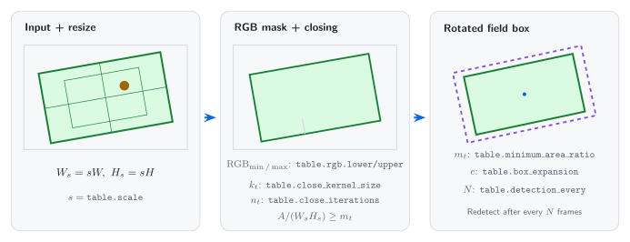
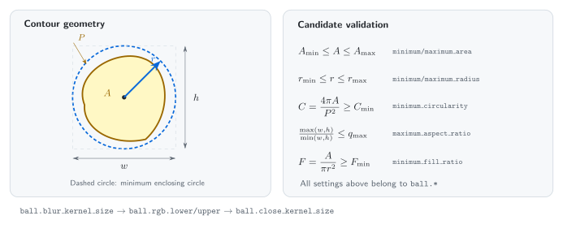
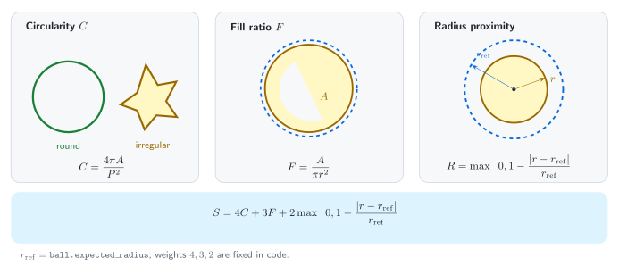
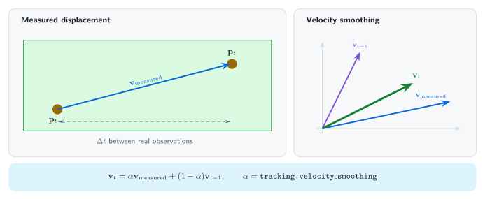
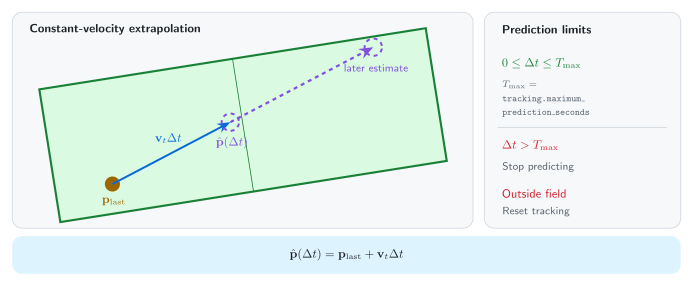
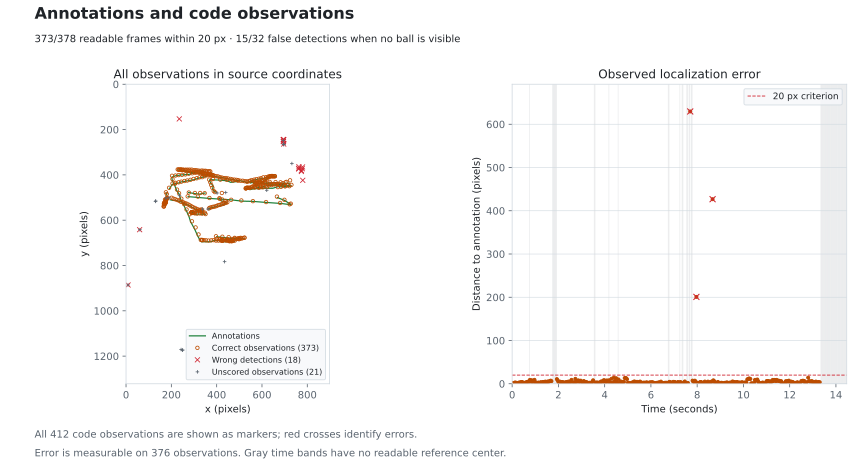
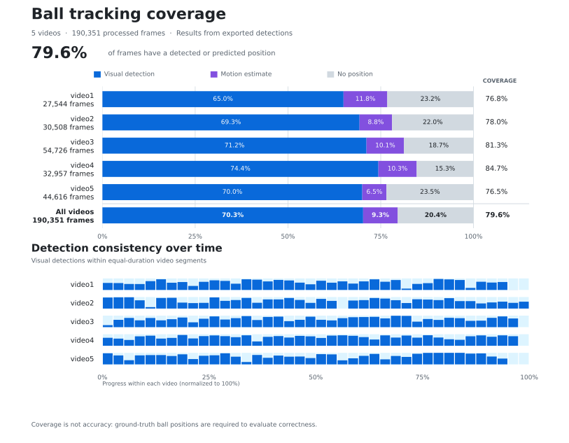

# Foosball Tracking

Détecte le terrain de baby-foot et suit la balle à l'aide des méthodes classiques d'[OpenCV](https://opencv.org/).

## Sommaire

- [Foosball Tracking](#foosball-tracking)
  - [Sommaire](#sommaire)
  - [Installation](#installation)
  - [Utilisation](#utilisation)
  - [Développement](#développement)
  - [Fonctionnement](#fonctionnement)
    - [1. Détection du terrain](#1-détection-du-terrain)
    - [2. Détection de la balle](#2-détection-de-la-balle)
    - [3. Suivi de la balle](#3-suivi-de-la-balle)
  - [Résultats](#résultats)
    - [Paramètres](#paramètres)
    - [Annotations et résultats du code](#annotations-et-résultats-du-code)
    - [Résultats du code sur cinq autres vidéos](#résultats-du-code-sur-cinq-autres-vidéos)
  - [Discussion et limites](#discussion-et-limites)

## Installation

```bash
uv sync --locked
```

## Utilisation

```bash
# Traiter toutes les images avec la configuration du projet.
uv run tracking --config config.jsonc

# Afficher un aperçu en direct pendant le traitement.
uv run tracking --config config.jsonc --preview
```

Le fichier [`config.jsonc`](config.jsonc) définit la vidéo source, les paramètres de sortie et les paramètres de détection. Adaptez cette configuration à la vidéo d'entrée avant de lancer le traitement.

## Développement

```bash
# Vérifier le code Python avec Ruff.
uv run ruff check .

# Vérifier le formatage sans modifier les fichiers.
uv run ruff format --check .

# Vérifier les types avec MyPy.
uv run mypy

# Vérifier les types avec Pyright.
uv run pyright

# Vérifier les erreurs avec Pylint.
uv run pylint --errors-only src

# Construire le paquet Python.
uv build
```

```bash
# Régénérer tous les graphiques de résultats à partir des JSON uniquement.
uv run poe figures

# Recalculer la comparaison enregistrée.
uv run poe evaluate

# Régénérer les exemples d'images et les vidéos de vérification.
uv run poe review

# Compiler les illustrations de la méthode.
uv run poe diagrams
```

```bash
# Générer le rapport au format PDF à partir du README.
pandoc README.md \
  --from=gfm+tex_math_dollars \
  --standalone \
  --top-level-division=section \
  -V documentclass=report \
  -V lang=fr-FR \
  -o README.tex \
&& latexmk -xelatex -shell-escape -halt-on-error README.tex
```

## Fonctionnement

### 1. Détection du terrain

L'image est réduite, puis la surface verte est segmentée en RGB. Une fermeture morphologique comble les petits espaces, avant de conserver le plus grand contour suffisamment étendu. Un rectangle orienté est ajusté autour de ce contour, puis ses coordonnées sont rétablies dans le repère de l'image d'origine.



### 2. Détection de la balle

Les pixels sont segmentés à l'intérieur du terrain. Les contours sont filtrés selon leur aire, leur rayon, leur rapport d'aspect, leur circularité et leur taux de remplissage. Le candidat obtenant le score le plus élevé est ensuite sélectionné.



Le classement des candidats repose sur la formule suivante :

$$
S = 4C + 3F + 2\max\left(0, 1-\frac{|r-r_{\mathrm{ref}}|}{r_{\mathrm{ref}}}\right)
$$

Ici, $`C=4\pi A/P^2`$ mesure la circularité, $`F=A/(\pi r^2)`$ mesure le taux de remplissage et $`r_{\mathrm{ref}}`$ correspond à `ball.expected_radius`. En cas d'égalité des scores, le candidat dont le rayon est le plus proche du rayon attendu est privilégié.



### 3. Suivi de la balle

La vitesse calculée à partir des observations réelles est lissée afin de réduire le bruit de mesure.



Lors de brèves occultations, la position est extrapolée à partir de la dernière observation et de la vitesse lissée. Une nouvelle observation est toujours prioritaire ; les prédictions ne sont jamais réutilisées comme observations.



## Résultats

### Paramètres

Une seule configuration, [`config.jsonc`](config.jsonc), a été ajustée manuellement aux couleurs de la vidéo.

| Composant            | Paramètres                                                                               |
| -------------------- | ---------------------------------------------------------------------------------------- |
| Couleur du terrain   | RGB `[30, 110, 65]` – `[145, 200, 175]`                                                  |
| Couleur de la balle  | RGB `[170, 140, 0]` – `[255, 255, 90]`                                                   |
| Géométrie du terrain | Échelle `0.5`, proportion minimale de surface `0.15`, redétection toutes les `60` images |
| Taille de la balle   | Aire `40–1400 px²`, rayon `4.5–28 px`, rayon privilégié `14 px`                          |
| Forme de la balle    | Circularité ≥ `0.3`, remplissage ≥ `0.15`, rapport d'aspect ≤ `4.5`                      |
| Suivi                | Prédiction ≤ `0.4 s`, lissage de la vitesse `0.7`                                        |

### Annotations et résultats du code

La vidéo de test contient 434 images à 30 images/s, avec une résolution de 898 × 1322 pixels.

- Les [annotations](docs/data/annotations.json) comprennent 378 centres de balle identifiables, 24 images incertaines exclues de l'évaluation et 32 images sans balle cible visible.
- Le fichier de [provenance](docs/data/provenance.json) enregistre la visibilité et les empreintes numériques.
- Le [JSON de comparaison](docs/data/comparison.json) associe les `frame_index` et évalue séparément les observations et les prédictions.

| Mesure                                                         | Résultat                 |
| -------------------------------------------------------------- | ------------------------ |
| Localisations observées correctes à 20 px près                 | 373/378 (98,7 %)         |
| Précision / rappel / F1 des observations                       | 95,4 % / 98,7 % / 97,0 % |
| Erreur médiane / moyenne de position                           | 3,16 px / 7,11 px        |
| Faux positifs observés sur les images sans balle cible visible | 15/32                    |

Le rappel de 98,7 % concerne les centres identifiables : 373 observations correctes, 3 localisations erronées et 2 images avec une prédiction uniquement. Le graphique complet inclut également 21 observations non évaluées et 15 fausses détections sur des images sans balle visible.



Les 412 observations sont conservées : les croix rouges indiquent les erreurs et les marqueurs gris les observations non évaluées. Le panneau temporel affiche l'erreur pour les 376 observations disposant d'un centre de référence identifiable ; les bandes grises signalent les intervalles sans centre identifiable.


```bash
# Traiter la vidéo entière.
uv run tracking input/video.mp4 --config config.jsonc

# Sauvegarder l'export complet par image utilisé pour la comparaison.
cp output/video.json docs/data/detections.json

# Comparer toutes les images aux annotations.
uv run poe evaluate

# Régénérer les graphiques à partir des fichiers JSON enregistrés.
uv run poe figures

# Actualiser les exemples d'images et la vidéo complète de comparaison.
uv run poe review
```

### Résultats du code sur cinq autres vidéos

Cinq vidéos supplémentaires totalisent 190 351 images, à environ 59,94 images/s et en résolution 1920 × 1080 pixels. Leurs exports enregistrés présentent une **couverture de 79,6 %**, correspondant à la proportion d'images pour lesquelles une observation ou une prédiction est disponible. Ces vidéos ne disposent pas d'annotations de référence : ce pourcentage ne mesure donc pas la précision de la localisation.



```bash
# Recalculer les comptes et les chronologies à partir des cinq exports JSON d'origine.
uv run reporting coverage output/video[1-5].json \
  --save-data docs/data/generic-videos.json
```

## Discussion et limites

Les résultats dépendent fortement de la configuration d'entrée. Les bornes RGB doivent correspondre aux couleurs et à l'éclairage de la vidéo. Si le masque du terrain échoue, la détection de la balle ne peut pas démarrer ; des bornes trop larges peuvent inclure des objets de couleur similaire. La résolution, la distance de la caméra et la perspective influencent également les valeurs adaptées pour les seuils d'aire, de rayon et les tailles des noyaux.

Dans cette évaluation, le réglage manuel fournit des localisations correctes pour la plupart des images dont la balle est identifiable. Cependant, les fausses observations sur les images sans balle cible visible montrent que l'algorithme confond encore certains objets avec la balle. Les paramètres de prédiction doivent également être adaptés à la vitesse du jeu et aux mouvements de caméra. L'extrapolation à vitesse constante ne peut pas prendre en compte les rebonds survenus pendant une occultation.

> Remarque : le module `reporting` et le code d'exportation des résultats du module `tracking` ont été développés à l'aide de l'IA.
