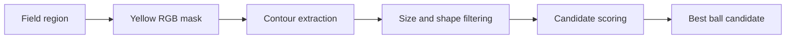
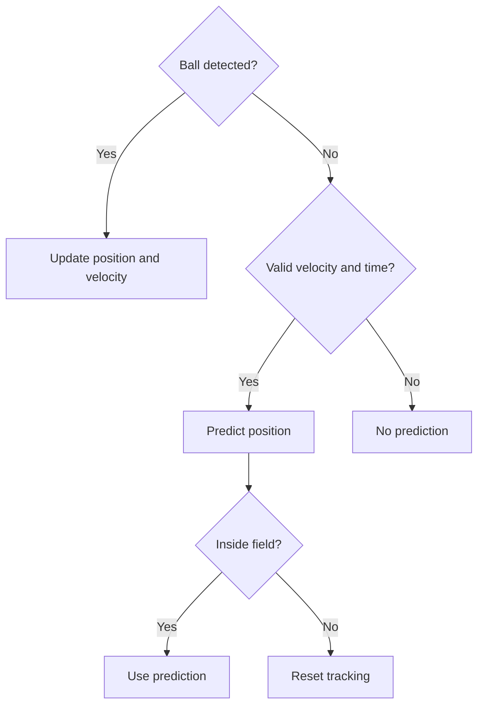

# Foosball Tracking

Detects the foosball playing field and tracks the ball in video using [OpenCV](https://opencv.org/). No machine learning required.

## Installation

```bash
uv sync --locked
```

## Usage

```bash
# Process the first 300 frames without opening a preview.
uv run foosball video.mp4 --output output/extract.mp4 --max-frames 300

# Display a live preview while processing.
uv run foosball video.mp4 --output output/preview.mp4 --preview

# Use a custom configuration.
uv run foosball --config config.jsonc

# Choose the number of concurrent ball detection workers.
uv run foosball --config config.jsonc --workers 4
```

Frames are read ahead in small batches bounded by `processing.buffer_size`
and assigned to the detection workers in turn. Every worker receives frames when the video is
long enough. Tracking, JSON export and video encoding preserve source order.
Progress includes the current worker's native thread ID and the number of
workers used so far. Decoding and encoding can still limit overall throughput.

## How it works

### 1. Field detection

The frame is resized to 50% for faster processing and converted from BGR to RGB. A color mask isolates the playing surface. Morphological closing connects separated regions, and the largest contour is kept if it covers at least 5% of the frame.

`cv2.minAreaRect` then fits a rotated rectangle around the contour, preserving the field's orientation. The original coordinates are restored, and the field is re-detected every 15 frames by default.


### 2. Ball detection

On every frame, detection is restricted to the field polygon. After Gaussian blur, an RGB mask identifies possible balls. Small gaps are closed before extracting contours.

Candidates are filtered by area ($`A \in [30, 400]\,\mathrm{px}^2`$), radius ($`r \in [4, 18]\,\mathrm{px}`$), aspect ratio, and circularity.

Circularity measures how closely a contour resembles a circle:

$$
C = \frac{4\pi A}{P^2}
$$

where:

- $`A`$ is the contour area (px²).
- $`P`$ is the contour perimeter (px).
- $`C`$ is the circularity score (dimensionless).

A perfect circle has $`C = 1`$, while lower values indicate increasingly irregular or elongated shapes.

Valid candidates are ranked using a weighted score:

$$
S = 4C + 3F + 2\max\left(0, 1 - \frac{|r-10|}{10}\right)
$$

where:

- $`C`$ is the circularity score.
- $`F = \dfrac{A}{\pi r^2}`$ is the fraction of the minimum enclosing circle occupied by the contour.
- $`A`$ is the contour area (px²).
- $`r`$ is the radius of the enclosing circle (px).

The score favors circular contours (weight 4), contours that fill their enclosing circle (weight 3), and candidates with a radius close to 10 px (weight 2).

The candidate with the highest score is selected as the ball.



### 3. Ball tracking

The tracker estimates velocity from two real ball positions and smooths it to reduce noise:

$$
\mathbf{v}_t = 0.7\,\mathbf{v}_{\text{measured}} + 0.3\,\mathbf{v}_{t-1}
$$

When the ball is temporarily hidden, its position is extrapolated from the last observed position using a constant-velocity model:

$$
\hat{\mathbf{p}}(\Delta t) = \mathbf{p}_{\text{last}} + \mathbf{v}_t\Delta t
$$

Prediction lasts at most 0.4 seconds and stops if the estimated point leaves the field. A new visual detection always takes priority; predictions are never reused as observations.



All thresholds and tracking settings can be adjusted in [`config.jsonc`](config.jsonc).

## Development

```bash
# Format Python files.
uv run ruff format .

# Lint the codebase.
uv run ruff check .

# Check types.
uv run pyright

# Check types with MyPy.
uv run mypy

# Check Pylint errors.
uv run pylint --errors-only src

# Build the package.
uv build
```
