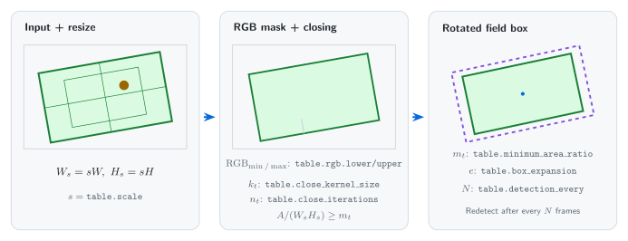
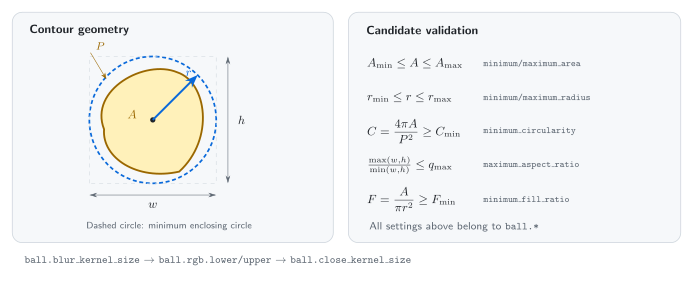
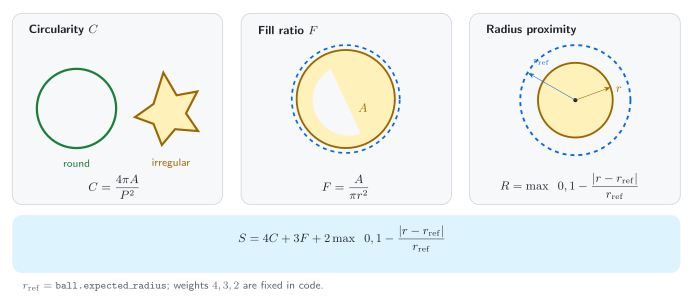
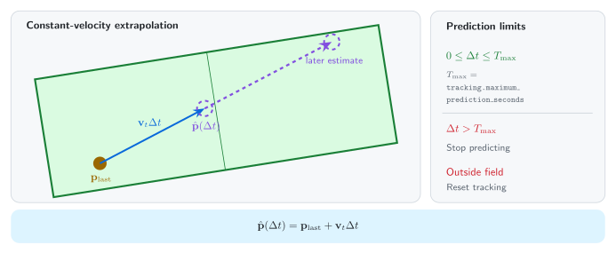
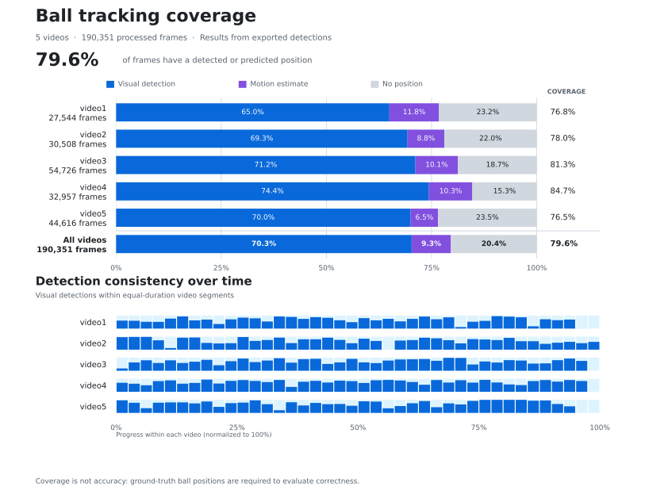

# Foosball Tracking

Detects the foosball playing field and tracks the ball in video using [OpenCV](https://opencv.org/). No machine learning required.

> [Version française](README.fr.md) de la documentation.

## Installation

```bash
uv sync --locked
```

## Usage

```bash
# Process the first 300 frames without opening a preview.
uv run foosball video.mp4 --output output/extract.mp4 --max-frames 300

# Display a live preview while processing.
uv run foosball video.mp4 --output output/preview.mp4 --preview

# Use a custom configuration.
uv run foosball --config config.jsonc

# Choose the number of concurrent ball detection workers.
uv run foosball --config config.jsonc --workers 4
```

## How it works

### 1. Field detection

The frame is resized using the `table.scale` factor for faster processing and converted from BGR to RGB. A color mask, bounded by `table.rgb.lower` and `table.rgb.upper`, isolates the playing surface. Morphological closing connects separated regions using `table.close_kernel_size` and `table.close_iterations`. The largest contour is kept if it occupies at least the fraction of the frame specified by `table.minimum_area_ratio`.

`cv2.minAreaRect` then fits a rotated rectangle around the contour, preserving the field's orientation. The original coordinates are restored, and the rectangle is expanded using `table.box_expansion` to outline the full table. The field is re-detected according to `table.detection_every`.



### 2. Ball detection

On every frame, detection is restricted to the field polygon. After Gaussian blur (kernel size `ball.blur_kernel_size`), an RGB mask defined by `ball.rgb.lower` and `ball.rgb.upper` identifies possible balls. Small gaps are closed using `ball.close_kernel_size` before extracting contours.

Candidates are filtered by area ($`A \in [A_{\min}, A_{\max}]`$), enclosing-circle radius ($`r \in [r_{\min}, r_{\max}]`$), aspect ratio, circularity, and fill ratio. These limits are defined in `config.jsonc` by `ball.minimum_area`, `ball.maximum_area`, `ball.minimum_radius`, `ball.maximum_radius`, `ball.maximum_aspect_ratio`, `ball.minimum_circularity`, and `ball.minimum_fill_ratio`.

Circularity measures how closely a contour resembles a circle:

$$
C = \frac{4\pi A}{P^2}
$$

where:

- $`A`$ is the contour area (px²).
- $`P`$ is the contour perimeter (px).
- $`C`$ is the circularity score (dimensionless).

A perfect circle has $`C = 1`$, while lower values indicate increasingly irregular or elongated shapes.



Valid candidates are ranked using a weighted score:

$$
S = 4C + 3F + 2\max\left(0,\ 1-\frac{|r-r_{\mathrm{ref}}|}{r_{\mathrm{ref}}}\right)
$$

where:

- $`C`$ is the circularity score.
- $`F = \dfrac{A}{\pi r^2}`$ is the fraction of the minimum enclosing circle occupied by the contour.
- $`A`$ is the contour area (px²).
- $`r`$ is the radius of the enclosing circle (px).
- $`r_{\mathrm{ref}}`$ is the expected ball radius (px), defined by `ball.expected_radius`.

The score favors circular contours (weight 4), contours that fill their enclosing circle (weight 3), and candidates with a radius close to $`r_{\mathrm{ref}}`$ (weight 2). These weights are fixed in the implementation, while the expected radius is configurable.

The candidate with the highest score is selected as the ball. If scores are tied, the candidate whose radius is closest to $`r_{\mathrm{ref}}`$ takes priority.



### 3. Ball tracking

The tracker estimates velocity from two real ball positions and smooths it to reduce noise:

$$
\mathbf{v}_t = \alpha\,\mathbf{v}_{\text{measured}} + (1-\alpha)\,\mathbf{v}_{t-1}
$$

where:

- $`\mathbf{v}_t`$ is the smoothed velocity at time $`t`$.
- $`\mathbf{v}_{\text{measured}}`$ is the velocity calculated from the two latest real ball observations.
- $`\mathbf{v}_{t-1}`$ is the previous smoothed velocity.
- $`\alpha`$ is the smoothing factor, defined by `tracking.velocity_smoothing`.


When the ball is temporarily hidden, its position is extrapolated from the last observed position using a constant-velocity model:

$$
\hat{\mathbf{p}}(\Delta t) = \mathbf{p}_{\text{last}} + \mathbf{v}_t\Delta t
$$

where:

- $`\hat{\mathbf{p}}(\Delta t)`$ is the predicted position after elapsed time $`\Delta t`$.
- $`\mathbf{p}_{\text{last}}`$ is the last visually observed ball position.
- $`\mathbf{v}_t`$ is the most recently estimated smoothed velocity.
- $`\Delta t`$ is the time since the last real observation (seconds).

Prediction lasts at most `tracking.maximum_prediction_seconds` seconds and stops if the estimated point leaves the field. A new visual detection always takes priority; predictions are never reused as observations.



All thresholds and tracking settings can be adjusted in [`config.jsonc`](config.jsonc).

## Performance results



## Development

```bash
# Format Python files.
uv run ruff format .

# Lint the codebase.
uv run ruff check .

# Check types.
uv run pyright

# Check types with MyPy.
uv run mypy

# Check Pylint errors.
uv run pylint --errors-only src scripts

# Build the package.
uv build

# Generate all diagrams.
uv run poe diagrams

# Delete all diagrams SVGs.
uv run poe diagrams-clean

# Run performance report on tested videos.
uv run poe performance <REPORTS...> --output <OUTPUT.svg>
```
