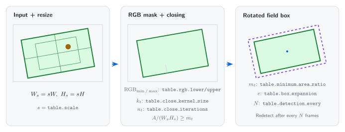
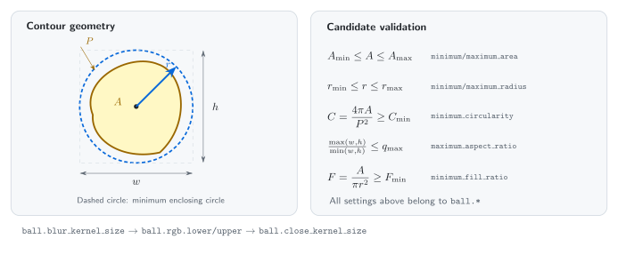
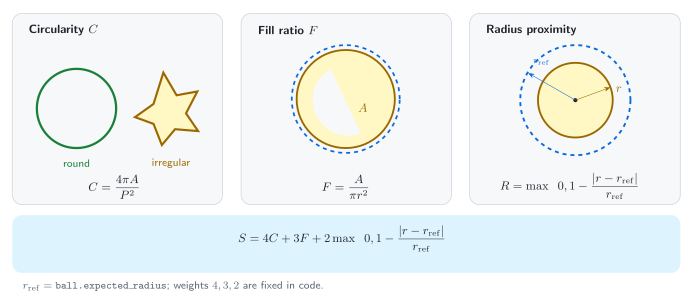
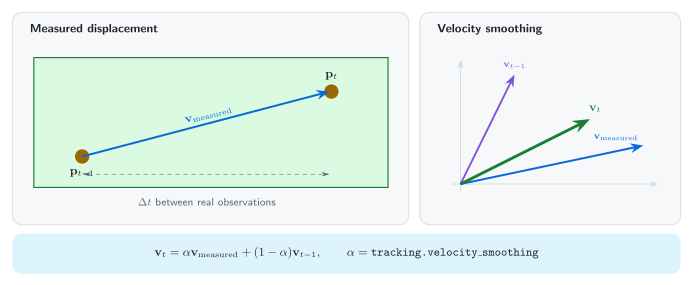
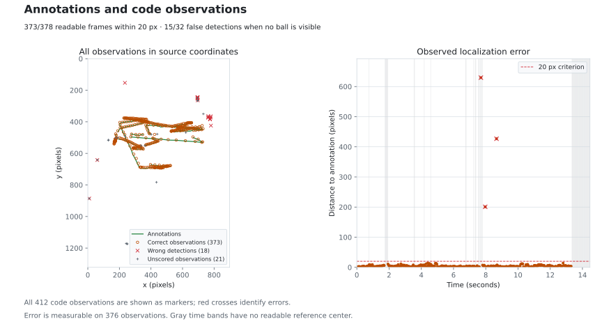
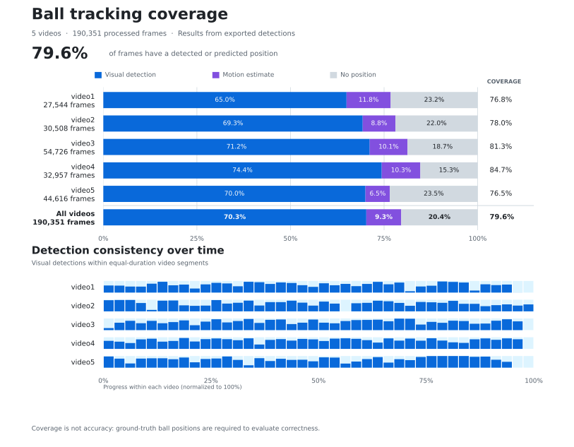

# Foosball Tracking

Detect the playing field and track the ball with classical [OpenCV](https://opencv.org/) methods.

> [Documentation française](README.fr.md)

## Contents

- [Foosball Tracking](#foosball-tracking)
  - [Contents](#contents)
  - [Installation](#installation)
  - [Usage](#usage)
  - [Development](#development)
  - [How it works](#how-it-works)
    - [1. Field detection](#1-field-detection)
    - [2. Ball detection](#2-ball-detection)
    - [3. Ball tracking](#3-ball-tracking)
  - [Results](#results)
    - [Parameters](#parameters)
    - [Annotations vs. code](#annotations-vs-code)
    - [Code vs. five generic videos](#code-vs-five-generic-videos)
  - [Discussion and limitations](#discussion-and-limitations)

## Installation

```bash
uv sync --locked
```

## Usage

```bash
# Process every frame using the project configuration.
uv run tracking --config config.jsonc

# Display a live preview during processing.
uv run tracking --config config.jsonc --preview
```

[`config.jsonc`](config.jsonc) selects the source video, output and detection settings. Adjust this configuration to the input video before processing it.

## Development

```bash
# Check Python code with Ruff.
uv run ruff check .

# Check formatting without modifying files.
uv run ruff format --check .

# Check types with MyPy.
uv run mypy

# Check types with Pyright.
uv run pyright

# Check Pylint errors.
uv run pylint --errors-only src

# Build the Python package.
uv build
```

```bash
# Regenerate all result charts from JSON only.
uv run poe figures

# Recompute the saved comparison.
uv run poe evaluate

# Rebuild frame examples and review videos.
uv run poe review

# Build method illustrations.
uv run poe diagrams
```

```bash
# Generate PDF from README file.
pandoc README.md \
  --from=gfm+tex_math_dollars \
  --standalone \
  --top-level-division=section \
  -V documentclass=report \
  -V lang=fr-FR \
  -o README.tex \
&& latexmk -xelatex -shell-escape -halt-on-error README.tex
```

## How it works

### 1. Field detection

Downscale the frame, segment its green surface in RGB, close small gaps and retain the largest sufficiently large contour. Fit an oriented rectangle, then restore original-image coordinates.



### 2. Ball detection

Segment pixels inside the field. Filter contours by area, radius, aspect ratio, circularity and fill ratio, then select the highest-scoring candidate.



Candidate ranking uses:

$$
S = 4C + 3F + 2\max\left(0, 1-\frac{|r-r_{\mathrm{ref}}|}{r_{\mathrm{ref}}}\right)
$$

Here, $`C=4\pi A/P^2`$ measures circularity, $`F=A/(\pi r^2)`$ measures fill, and $`r_{\mathrm{ref}}`$ is `ball.expected_radius`. Equal scores are resolved by the closest radius.



### 3. Ball tracking

Smooth velocity from real observations to reduce measurement noise.



During short occlusions, extrapolate from the last observation using the smoothed velocity. A new observation takes priority; predictions are never reused as observations.


## Results

### Parameters

One configuration, [`config.jsonc`](config.jsonc), was manually adjusted to the colors in video.

| Component      | Settings                                                              |
| -------------- | --------------------------------------------------------------------- |
| Field color    | RGB `[30, 110, 65]` – `[145, 200, 175]`                               |
| Ball color     | RGB `[170, 140, 0]` – `[255, 255, 90]`                                |
| Field geometry | Scale `0.5`, minimum area ratio `0.15`, redetection every `60` frames |
| Ball size      | Area `40–1400 px²`, radius `4.5–28 px`, preferred radius `14 px`      |
| Ball shape     | Circularity ≥ `0.3`, fill ≥ `0.15`, aspect ratio ≤ `4.5`              |
| Tracking       | Prediction ≤ `0.4 s`, velocity smoothing `0.7`                        |

### Annotations vs. code

Tested video contains 434 frames at 30 fps, 898 × 1322 pixels.

- The [annotations](docs/data/annotations.json) contain 378 readable centers, 24 uncertain frames excluded from scoring and 32 frames without a visible target ball.
- The [provenance](docs/data/provenance.json) records visibility and hashes.
- The [comparison JSON](docs/data/comparison.json) matches `frame_index` and scores observations separately from predictions.

| Measurement                                          | Result                |
| ---------------------------------------------------- | --------------------- |
| Correct observed locations within 20 px              | 373/378 (98.7%)       |
| Observation precision / recall / F1                  | 95.4% / 98.7% / 97.0% |
| Median / mean position error                         | 3.16 px / 7.11 px     |
| Observed false positives on nonvisible-target frames | 15/32                 |

The 98.7% recall covers readable centers: 373 correct observations, 3 wrong locations and 2 frames with prediction only. The full plot also includes 21 unscored observations and 15 false detections on frames without a visible ball.



All 412 observations are retained: red crosses mark errors and gray markers are unscored. The time panel shows error on the 376 observations with a readable reference center; gray bands mark intervals without one.


```bash
# Process all of video.
uv run tracking input/video.mp4 --config config.jsonc

# Save the full per-frame export used by the comparison.
cp output/video.json docs/data/detections.json

# Compare every frame against the annotations.
uv run poe evaluate

# Regenerate result charts from the saved JSON files.
uv run poe figures

# Refresh frame examples and the full comparison video.
uv run poe review
```

### Code vs. five generic videos

Five additional videos total 190,351 frames at approximately 59.94 fps and 1920 × 1080 pixels. Their recorded exports give 79.6% coverage: the fraction of frames with an observation or prediction. They have no reference annotations, so this does not measure localization accuracy.



```bash
# Recompute counts and timelines from the five original JSON exports.
uv run reporting coverage output/video[1-5].json \
  --save-data docs/data/generic-videos.json
```

## Discussion and limitations

Results depend strongly on the input configuration. RGB bounds must match the video's colors and lighting. If the field mask fails, ball detection cannot start; overly broad bounds admit similarly colored objects. Resolution, camera distance and perspective also change the appropriate area, radius and kernel settings.

The manual configuration gives accurate locations on most readable frames here, but the false observations on nonvisible-target frames show that it still confuses some objects with the ball. Prediction settings must also match game speed and camera motion. Constant-velocity extrapolation cannot account for hidden rebounds.

> Note: The `reporting` module and the results export code in the `tracking` module were developed with AI assistance.
